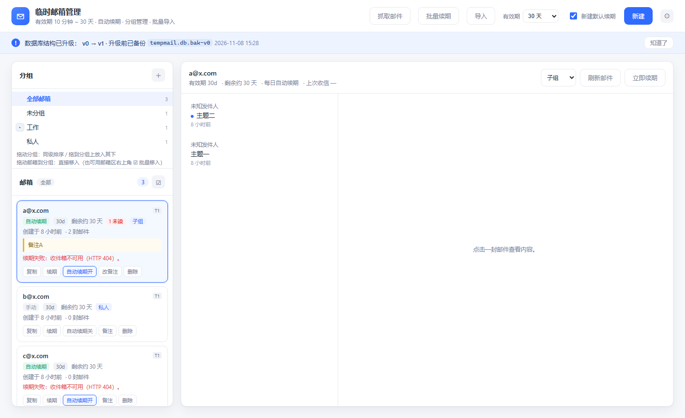

# 排错指南

## 启动类

**端口被占用**
```
OSError: [WinError 10048] 通常每个套接字地址只允许使用一次
```
改端口：`set TEMPMAIL_PORT=8899 && python run.py`

**页面能开但接口全 404**
确认访问的是 `http://127.0.0.1:8720/`（带结尾斜杠无所谓），而不是文件路径直接打开 `index.html`。前端靠相对路径 `/api/...`，必须走 Flask。

**打包后的 exe 双击闪退**
用 cmd 运行 exe 看报错；或看 `data/tempmail.log`。最常见是模板没打进去（`TemplateNotFound: index.html`），说明 `build.py` 的 `--include-data-dir` 没生效，删 `build/` 重编。

## 业务类

**「创建临时邮箱失败。」/ HTTP 502**
按顺序查：
1. 浏览器打开 https://onetimeemail.com 是否正常（站点挂了或被墙）
2. 换网络试试（站点可能限流）
3. 站点改版 → 对照 `交接/站点协议.md` 重抓 `app.js`
4. 看 `data/tempmail.log` 里 `SiteError` 的原始 message

**「页面中未找到 CSRF token」**
站点页面结构变了，或拿到的不是语言首页。检查 `config.py` 的 `SITE_LANG` / `SITE_PREFIX`，并更新 `client.py` 里的 `_CSRF_META` 正则。

**创建成功但有效期还是 1h**
`create_inbox()` 里的 `update_lifetime` 抛异常会被吞掉（为了保证邮箱已创建成功不算失败）。看日志有没有「续期失败」，再手动点「立即续期」。

**收信报「收件箱不可用或已过期」**
uuid 在站点侧已失效：可能超过 30 天没访问，或站点清库。这类邮箱只能删掉重建。恢复短语可以去官网 `#/restore` 试恢复。

**邮件列表一直空**
- 确认收件地址复制正确（人名格式，如 `christopher.stewart4044@mycloudmail.net`）
- 有些站点会拒收临时邮箱，发件方可能直接丢弃
- 手动点「刷新邮件」；接口是按需拉取，没有推送

**自动续期没生效**
- 该邮箱卡片的按钮是否显示「关闭自动续期」（说明已开启）
- 程序必须一直运行，关闭期间不续期
- 看 `data/tempmail.db` 的 `last_renewed_at` 是否在 24 小时内
- 调度器每 5 分钟巡检一次（`TEMPMAIL_TICK` 可调），刚启动等 5 秒 + 一轮

**邮件正文空白**
站点只提供 HTML 时不返回 `body_text`，代码会优先渲染 `body_html`；两者都空说明站点本身没给正文（可能是不支持的邮件类型）。详情面板会显示「(空内容)」。

## 数据类

**数据库在哪**
`data/tempmail.db`（相对 exe 或项目根目录）。用环境变量 `TEMPMAIL_DATA_DIR` 可改到别处。

**想看/改数据**
```bash
python -c "import sqlite3;c=sqlite3.connect('data/tempmail.db');print(c.execute('select id,email,uuid,auto_renew,last_renewed_at from mailboxes').fetchall())"
```

**误删邮箱能恢复吗**
本地不行。若保存过 uuid 或 12 词恢复短语，可以去官网用恢复短语找回（前提是站点侧未过期）。

## 打包类

**Nuitka 编译卡在下载 MinGW / 找不到 cl.exe**
脚本带 `--assume-yes-for-downloads`，会自动下 MinGW。若公司网络拦截，先装 Visual Studio Build Tools（勾选 C++ 生成工具）再编。

**exe 体积大（30MB+）**
Nuitka 会把 Python 运行时整个带上，属正常。想更小可换 `--standalone` 目录模式分发压缩包。

**exe 启动慢（2-5 秒）**
单文件模式要先解包到临时目录。追求启动速度用 `python build.py --standalone`，产物是目录，直接跑 `TempMailManager.exe`。

**单文件 exe 双击后没反应：进程在跑、CPU 100%、端口不监听、连 `data/` 都不建**
症状：`%TEMP%` 下出现 `onefile_<pid>_xxx` 目录，40 个文件只解出 39 个，
进程单线程空转，控制台一个字都不打印（说明还没进入 Python 代码，卡在 Nuitka 引导层）。
这是 Nuitka 单文件引导器偶发的问题，与业务代码无关（同一份源码用 `--standalone` 跑完全正常）。

解决办法：给引导器指定固定解包目录，打包时加

```
--onefile-tempdir-spec={TEMP}/TempMailManager-<版本>
```

例如 `github/version/TempMailManager-v1.0.0-win64.exe` 就是这样打出来的，
启动时解包到 `%TEMP%\TempMailManager-1.0.0` 并复用，第二次启动更快。

排查小技巧：`ls -dt %TEMP%/onefile_*` 找到解包目录，与 `build/run.dist` 的文件清单比，
缺哪个文件就说明解包停在哪一步；`build/run.dist` 两份构建的文件清单一致，就排除了源码问题。

**强杀 exe 后 `%TEMP%` 留下大量 `onefile_*` 目录**
Nuitka 正常退出时会自己删解包目录，强杀（任务管理器结束进程 / `Stop-Process -Force`）会留下。
每个约 44MB，攒多了会占上 GB。关掉所有 TempMailManager 进程后整目录删掉即可，不影响数据
（`data/` 在 exe 同级，不在解包目录里）。

## 补充：删除时偶尔「返回非 JSON」

高频连续调用创建/删除接口时，站点可能返回一个 HTML 页面（典型是限流或人机校验页），而不是 JSON。

- 代码里 `delete_inbox()` 已经吞掉这个异常，只返回 False，本地照删，日志记 warn。
- 所以「站点上还残留一个邮箱」不是 bug，等一段时间再手动删或让它自己过期即可。
- 遇到这种情况不要连续重试，会加剧限流。

## 导入相关

**提示「没有可导入的内容」**
文本框是空的，或文件读出来是全空白。文本文件请存成 UTF-8；GBK 也能自动识别。

**某些行没导入，显示「无法识别（缺 uuid）」**
该行里没有 `8-4-4-4-12` 格式的 uuid。uuid 才是导入必需的，助记词可以不填。表头行（含 uuid/助记词/phrase 等词）会被静默跳过，不算错误。

**显示「重复，未导入」**
分三种原因，清单里会写明：`该 uuid 已在列表中`、`该邮箱地址已在列表中`、`与本文件第 N 行重复`。想重新导入就先删掉本地对应的邮箱。

**显示「导入失败：收件箱不可用或已过期」**
uuid 在站点侧已失效（超过 30 天未访问、被删除，或本来就是编造的）。这类账户无法恢复，只能忽略。导入不需要 Cookie，但必须能连通站点——因为邮箱地址要用 uuid 换回来。

**Excel 只导入了第一个工作表**
设计如此，只解析 workbook 里登记的第一个 sheet。

**Excel 解析失败 / 报「不是有效的 xlsx 文件」**
说明文件不是标准 xlsx（可能是 .xls 改名，或文件损坏）。xlsx 解析用的是自带的
`app/services/xlsx_reader.py`（zipfile + ElementTree，无第三方依赖），支持共享字符串、
内联字符串、数字单元格；不支持 .xls 老格式。

**.xls（老格式）导入报错**
只支持 xlsx。用 Excel 另存为 xlsx，或导出为 csv 走文本导入。

**导入几十行很慢**
每行都要请求一次站点换邮箱地址，正常现象（几十行约 10-20 秒）。单次上限 300 行。

## 分组相关

**删除分组会删邮箱吗**
不会。子分组会一起删除，组内邮箱回到「未分组」。

**为什么选中父分组能看到子分组的邮箱**
筛选口径是「子树包含」，计数也是。想只看直属，目前不支持。

**移动分组报「不能把分组移动到它自己或它的子分组下」**
防环校验，属于预期行为。

## 模板相关

**照抄模板导入，显示 3 条「导入失败」**
正常现象。模板里的 3 个示例 uuid 是虚构的，只用来演示格式，把它们替换成自己的账户再导入。

**下载下来的文件名是 `.xlsx` 或乱码**
响应头同时给了 `filename`（ASCII 兜底）和 `filename*`（中文名）。极老的客户端可能只认前者，换现代浏览器即可。

## 抓信与续期（2026-11-06 之后）

**日志里曾经成片的 `/refresh 502`**
那是旧版本的 30 秒轮询在失败后仍不停重试造成的。现在已取消自动轮询，只在手动「抓取邮件」时请求站点，且任务会记录每个邮箱的成功/失败，不会无限重试。

**单个邮箱在任务里一直失败**
`收件箱不可用或已过期` 表示该 uuid 在站点侧已失效，重试不会好，直接删掉重建即可。其它提示（延迟/连接超时）通常是网络抖动，隔一会儿重新抓一次。

**点了「抓取邮件」没反应**
任务面板有个前提：至少勾选一个邮箱，「下一步」才可点。若提示「已有任务在运行」，等当前任务结束或点「终止任务」。

**关闭面板后任务还在跑吗**
在。任务跑在服务端线程里，关面板只是不看进度；关掉程序才会中断（重启后任务不恢复，已抓到的邮件不受影响）。

**续期没有按设定时间跑**
- 设置里「启用自动续期调度」是否打开
- 邮箱卡片是否显示「自动续期开」
- `data/schedule_state.json` 里的 `last_renew_run` 是不是刚跑过（间隔模式要等够 N 小时）
- daily 模式要注意：程序在设定时间之后才启动，会立刻补跑一次，当天不会再跑第二次

**改了设置要重启吗**
不用。每次巡检都会重新读 `data/settings.json`（按 mtime 判断变更），保存即生效。

**设置保存了但值被改回去**
服务端会做范围校验：间隔 0~60000ms、`interval_hours` 1~720、随机 min 大于 max 会自动交换。
另外环境变量优先级更高（`TEMPMAIL_RENEW_MODE`、`TEMPMAIL_RENEW_HOURS`、`TEMPMAIL_DAILY_TIME`、`TEMPMAIL_RENEW_LIFETIME`、`TEMPMAIL_RENEW_ENABLED`），排查时确认没有残留。

**配置文件在哪**
`data/settings.json`（抓信/续期配置，可手工编辑）、`data/schedule_state.json`（上次触发时间，删掉会立即补跑一次续期）。

## 任务与数据存储

**关掉网页任务会停吗**
不会。任务跑在服务端线程里，关页面只是不看进度；重新打开会自动接上（顶栏按钮会显示 `抓取邮件 2/5`）。

**关掉程序（或重启电脑）后任务怎么办**
任务中断。重启后启动逻辑会把上次遗留的 running 任务标成「中断」，历史里能看到中断前完成了几个。

**数据到底存在哪**
全部在 `data/tempmail.db`。配置和调度状态在 `settings_kv` 表，任务在 `jobs` / `job_items` 表。
升级后如果看到 `settings.json.migrated`、`schedule_state.json.migrated`，那是旧版本文件被自动归档，确认新版本正常后可删。

**任务历史最多保留多少**
200 条（超出自动清理最旧的），前端默认展示最近 30 条。

## 数据库结构与升级

**升级到新版后，data/ 里多了一个 `tempmail.db.bak-v0`，能删吗**
能。那是升级前的整库快照（v1.0.0 的库结构没有 `sort_order` 列）。确认新版一切正常后可以删；
想回滚就把它改回 `tempmail.db`（先关程序，同时删掉 `tempmail.db-wal` / `tempmail.db-shm`）。

**升级有没有提示**
三处都能看到：① 启动控制台打印「数据库结构已升级：v0 → v1，升级前已备份 …」；
② 界面顶部一条浅蓝提示条，写明前后版本、备份文件名和时间，点「知道了」消失；
③ 设置 →「运行日志」里一条 `db_migrate` 记录。
只有**真的发生了结构变更**才会出现——如果老库本来就是最新结构，什么都不会提示。



**为什么有时启动后看不到升级提示**

这不是漏了提示，而是"真的没有结构变更"。分两种情况：

1. **全新安装**：建表语句（`SCHEMA`）直接就是最新结构（v1，含 `sort_order` 与
   `idx_mailboxes_group` 索引），启动时结构自检通过，只写版本号——无事可升，不提示。
2. **老库已经是最新结构**：比如数据库曾经历过一次升级，`schema_version` 已是 1，
   再次启动时结构自检通过，同样不提示。

只有「老库真的缺结构」（如用 `tools/make_old_db.py` 造的 v0 旧库：无 `schema_version` 表、
无 `sort_order` 列）时，才会看到完整提示链：控制台打印 → 页面顶部浅蓝横幅 →
`data/tempmail.db.bak-v0` 备份 → 「运行日志」里的 `db_migrate` 记录。

实测对照：

| 交给程序的库 | 结构特征 | 结果 |
|---|---|---|
| 全新空目录 | 无库 | 建表即最新（v1），静默，无备份 |
| 已是 v1 的库 | 有 `schema_version=1`、有 `sort_order` | 静默，无备份 |
| 真 v0 旧库（`tools/make_old_db.py` 造） | 无 `schema_version`、无 `sort_order` | 横幅 + `.bak-v0` + `db_migrate` 日志 |

**想亲手验证一次升级**
用 `tools/make_old_db.py` 造一份 v1.0.0 结构的示例库（没有 `schema_version`、没有 `sort_order`）：

```bash
python tools/make_old_db.py 旧库样本
TEMPMAIL_DATA_DIR=旧库样本/data python run.py     # cmd 下用 set TEMPMAIL_DATA_DIR=...
```

启动后应看到控制台提示、页面顶部提示条，`旧库样本/data/` 下多出 `tempmail.db.bak-v0`，
分组顺序和邮箱备注都还在。删掉整个 `旧库样本/` 即可重来。

**批量续期把邮箱续到了别的时长**
批量续期（以及自动续期）统一用设置里的「续期时长」：
- 设置成具体天数（如 3 天）→ 所有参与的邮箱都被续到 3 天，**覆盖邮箱原本的有效期**
- 选「保持各邮箱当前有效期」→ 每个邮箱按自己当前的有效期续，时长不变
- 单个邮箱的「续期」按钮则是弹窗自选时长，默认「保持当前有效期」
设置项下方有提示文字说明这一点。

**怎么确认当前库是什么版本**
```bash
python -c "import sqlite3;print(sqlite3.connect('data/tempmail.db').execute('select version from schema_version').fetchone())"
```
或直接 `python -m app.migrations data/tempmail.db`，已是最新时会打印「无需升级」。

## 日志

**界面上在哪看日志**
齿轮（设置）→ 左下角「运行日志」。可以按级别筛选（信息/警告/错误），也能一键清空。
以前只有 `/api/logs` 接口没有入口，现在补上了。

**日志和 tempmail.log 有什么区别**
- `logs` 表（界面里的运行日志）：业务动作，如"创建邮箱 xxx""任务结束：成功 3，失败 0"
- `data/tempmail.log`：进程级日志，含 Werkzeug 访问日志和未捕获异常堆栈

排查 500 先看 `tempmail.log` 的堆栈，再看界面日志里的「异常」条目。

**日志会无限增长吗**
不会。超过 2000 条自动裁剪最旧的；清空后会保留一条"清空运行日志 N 条"的记录。

**tempmail.log 不再更新了**
正常。运行日志已全部入库，进程日志只走控制台。要排查问题用界面上的「日志中心」（设置 → 运行日志）。

**日志中心的外部请求页签，响应里的 uuid 是 `xxxxxxxx…`**
出库统一脱敏：uuid 只留前 8 位、助记词和 PHPSESSID 打码成 ***。这是防止日志泄露邮箱所有权。
数据库里存的是完整原文，需要原文时用 `GET /api/logs?kind=http&raw=1`（或直接查 `http_logs` 表）。

**界面日志时间和本地对不上（差 8 小时）**
老版本写入时用了 UTC。启动时会自动把历史记录平移到本地时区（一次性，靠 settings_kv 的旗标防止重复执行），新日志直接写本地时间。

**前端请求日志里没有记录静态资源**
设计如此：`/static/`、`/favicon.ico` 与 `/api/logs` 自身跳过，避免每次刷新页面刷出几十条。

## 邮件「放大查看」第二次打开白板

**现象**：第一次放大正常，关闭后再放大只有标题和发件人、正文区一片空白；刷新页面后又正常。

**原因**：弹窗里的 iframe 是复用同一个节点，通过 `iframe.srcdoc = 文档` 反复赋值。
同一节点重复赋同样的 srcdoc 时，浏览器可能不会重新导航；若弹窗隐藏期间该 iframe 的文档被回收，
再次显示就会得到空白（不同浏览器/时机表现不一，所以不一定每次都复现）。

**修复**：`app/static/app.js` 的 `openModal()` 每次都新建一个 iframe 节点替换旧节点，
先让弹窗显示（保证 iframe 有布局）再写入 srcdoc，因此每次打开都是全新导航；
`closeModal()` 关闭时会移除 srcdoc 释放旧文档。右侧详情区的 iframe 由 `renderDetail()`
每次重新生成，本来就不受这个影响。

验证时用真实应用做了「打开→关闭→再打开」的自动化断言：
`recreated=true`、`srcdoc=1127`、`connected=true`、`count=1`（没有残留重复节点），内容正常渲染。

## 点了邮件，邮箱卡片的「N 未读」不消失（要刷新才掉）

**原因**：`GET /api/emails/<id>` 在返回前就把 `is_read` 置为 1，所以响应体里的 `is_read` 永远是真，
前端原来用 `if (!email.is_read)` 判断「刚才是未读」，这段逻辑从来没执行过，邮件列表和邮箱卡片的未读数都不会更新。

**修复**：`app/static/app.js` 的 `openEmail()` 在请求**前**先看本地列表里这封是否未读（`wasUnread`），
是的话读信后再 `loadEmails()` 并 `syncUnreadBadge(mailbox_id)` 把卡片未读数减一、重绘列表。

验证：库里把一封邮件改 `is_read = 0`，按「打开→读信」自动断言，未读数 2 → 1，列表未读样式同步消失。

## 新增邮箱时长选项

站点白名单在 `app/config.py` 的 `LIFETIME_OPTIONS`，中文名在 `LIFETIME_LABELS`。
新增一个时长：两处都加，`/api/health` 会把标签带给前端，设置里的「续期时长」下拉自动跟着变。

## 端口被旧进程占用，页面还是老版本

打包版 `TempMailManager.exe` 和 `python run.py` 都监听 127.0.0.1:8720，先启动的会占住端口，
后启动的静默失败，浏览器看到的仍是旧页面（模板在非 debug 模式下有缓存，更容易误判）。
排查：`netstat -ano | grep 8720` 看 PID，`taskkill /PID <pid> /F` 后再启动。

## 拖动分组/邮箱没反应

- 分组拖到另一分组**中间**才是「放进去」，拖到行首/行尾是同级排序；跨层级时行首行尾无效（按放入处理）。
- 分组不能拖进自己或自己的子孙（`TM.subtreeIds` 拦截），此时不会出现蓝色高亮。
- 邮箱卡片必须在**非批量管理**模式下才能拖（管理模式卡片 `draggable=false`），
  拖到「全部邮箱」行无效，拖到「未分组」是移出分组。
- 拖拽依赖 HTML5 Drag & Drop，触摸屏/移动端浏览器不支持，请用批量管理入口。

## 批量移入后列表没变化

移动成功后前端会 `reload()`；如果你正在某个分组筛选视图里，被移走的邮箱本来就会从该视图消失，
切到「全部邮箱」即可看到新归属。批量管理退出时会清空勾选。
